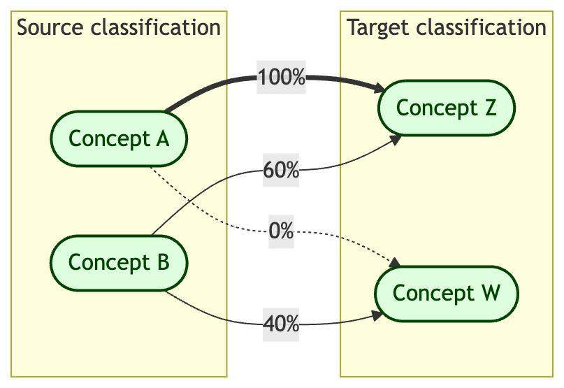

# ecoSynthesis (0.0.0.9000)

*This package is a work in progress and is not yet ready for use. Please
check back later for updates.*

Please find more information about the Environmental Indicators
Initiative here;
<https://ardc.edu.au/project/environmental-indicators-initiative/>, and
the Ecosystem Indicator Workflows project here;
<https://ardc.edu.au/project/ecosystem-indicator-workflows/>.

------------------------------------------------------------------------

The goal of `ecoSynthesis` is to assist users in the synthesis of
cross-referencing information between two classification systems. The
examples in this package focus on ecosystem classifications, and
specifically on cross-referencing from local classifications to a global
standard classification, but functions are designed to work with any
pair of classification systems.

The process of cross-reference implies a source classification and a
target classification, where the target classification might have a
broader scope than the source. Elements in the source classification can
be interpreted as directly related to one or more elements in the target
classification. This relationship can be quantified as membership
values, where the source element has memberships between 0 and 100% to
each element of the target classification.



Diagram

The membership table (long format) looks like this (assuming all other
possible pairs have 0% membership).

| Source Classification | Target Classification | Membership |
|-----------------------|-----------------------|------------|
| Concept A             | Concept Z             | 100%       |
| Concept B             | Concept W             | 60%        |
| Concept B             | Concept Z             | 40%        |

## Installation

You can install the development version of ecoSynthesis from
[GitHub](https://github.com/) with:

``` r

# install.packages("pak")
pak::pak("Ecosystem-Indicators-Workflows/ecoSynthesis")
```

## Example

This is a basic example which shows you how to solve a common problem:

``` r

library(ecoSynthesis)

input_table <- data.frame(
  re1 = c(
    "Semi-deciduous Forest",
    "Deciduous Forest",
    "Wet Montane Forest",
    "Dry Montane Forest"
  ),
  efg1 = c("T1.1", "T1.2", "T1.1", "T1.2"),
  memb1 = c(80, 80, 70, 50),
  efg2 = c("T1.2", "T1.1", "T1.3", "T1.3"),
  memb2 = c(20, 20, 30, 50)
)

membership_table(
  input_table,
  "re1",
  c("efg1", "efg2", "efg3"),
  c("memb1", "memb2"),
  target = "T1.3"
)
```

This package implements recommended methods from:

> IUCN (2025). Standards, methods and guidelines for cross-referencing
> ecosystem classifications and maps to the IUCN Global Ecosystem
> Typology. Version 1.0. Keith, D. A., Dayaram, A., Driver, A.,
> Ferrer-Paris, J. R., Francis, R., Hay, S., Murray, N. J., Nicholson,
> E., Santos, J., Skowno, A. L. & Tozer, M. G. (Eds.). Gland,
> Switzerland: IUCN. ISBN: 978-2-8317-2348-8. <DOI:10.2305/CPPC6126>.

This package in in the very early stages of development.
